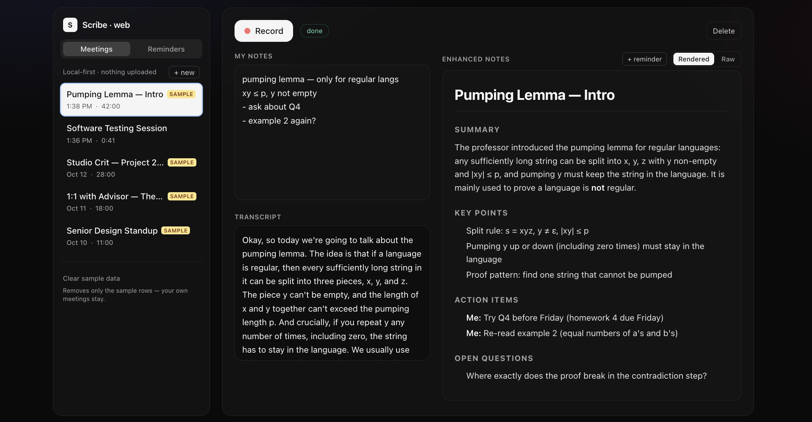
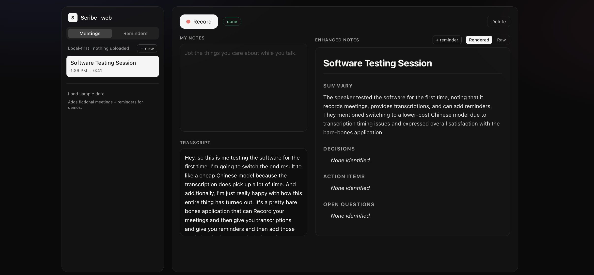
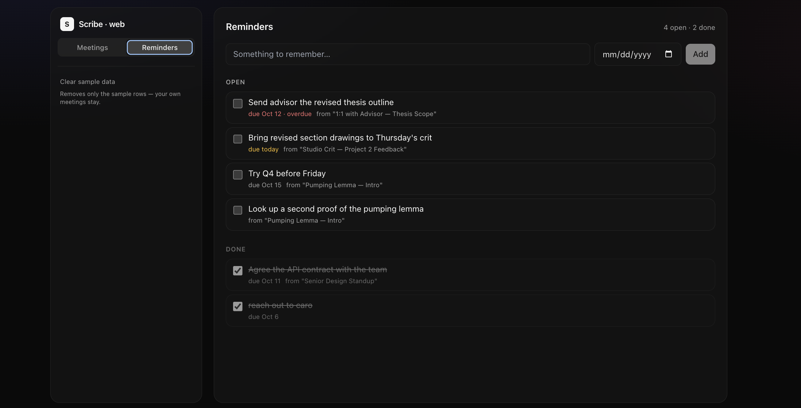
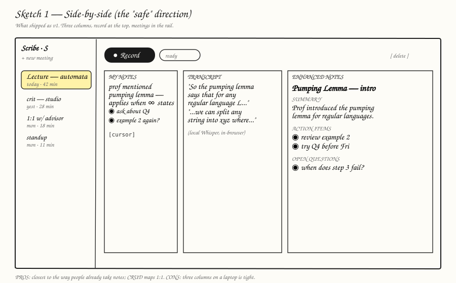
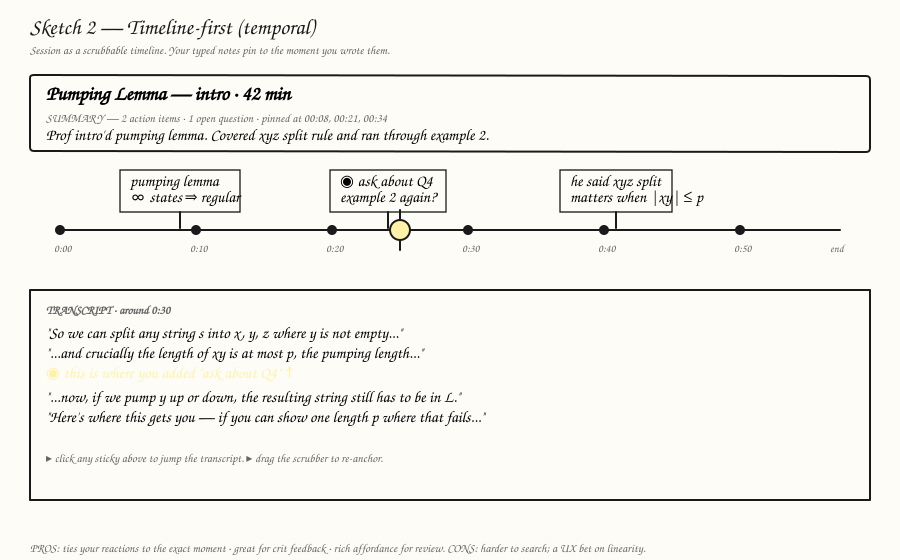
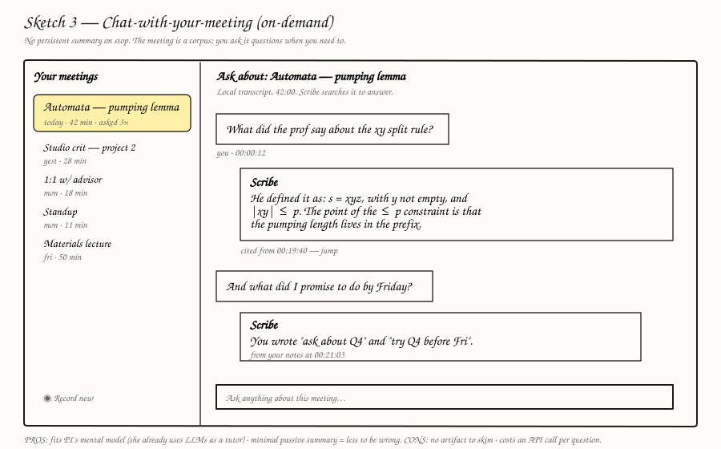

<div align="center">

# Scribe

**A local-first AI meeting notepad for the browser.**
Record a lecture, crit or meeting. Whisper transcribes it on your device; only the text goes to an LLM for a titled summary with action items.

[**Live demo**](#) &nbsp;·&nbsp; [**Demo video**](#) &nbsp;·&nbsp; [Native app](https://github.com/AdityaPawarr7/scribe)

`Vite` `React` `TypeScript` `Tailwind` `Dexie / IndexedDB` `Whisper (in-browser)` `Vercel Edge` `Concentrate API`

</div>

> Built for *Applied AI Tools, Project 1: Human-guided software development*.
> **Disclosure:** I work at Concentrate AI. Scribe uses the Concentrate API for model access.

| | |
|---|---|
| **Private by design** | Audio never leaves your browser; only transcript text is sent, and only when you ask for a summary |
| **Free to run** | Local Whisper, free-tier model, no accounts |
| **Two CRUD entities** | Meetings and Reminders, stored in IndexedDB, 20 automated tests |
| **Built with documented AI use** | 16 logged experiments and a reusable protocol, below |

**Jump to:** [Screenshots](#screenshots) · [Use it](#how-to-use-it) · [How it works](#how-it-works) · [1 Problem](#1-problem) · [2 Research](#2-research) · [3 Prototype](#3-prototype) · [4 Testing](#4-testing-and-deployment) · [GenAI experiments](#genai-experiments) · [Protocol](#protocol-for-using-genai-on-a-project-like-this) · [Run locally](#run-locally)

---

## Screenshots

**Meeting view** with sample data: my notes, transcript and enhanced notes side by side, SAMPLE badges in the sidebar.


**A real recording**, transcribed locally and summarised (the 41 s test clip, no notes typed).


**Reminders dashboard:** open and done, due dates (overdue / today), and a backlink to the source meeting.


## How to use it
1. Open the live demo in Chrome or Edge and click **+ new**.
2. Type rough notes if you like, then **Record** and allow the mic.
3. Click **Stop**. The first time, the Whisper model downloads once and is cached; then the transcript appears with a progress indicator.
4. Enhanced notes appear automatically. Toggle **Rendered / Raw** to see or edit the markdown.
5. Use **+ reminder** on an action item; manage reminders under the **Reminders** tab.
6. No mic handy? Use the **sample data** buttons in the sidebar (fictional, badged SAMPLE, removable without touching your own data).

## How it works
Audio is captured and transcribed in the browser. Only text crosses the network, and only when a summary is generated.

```
Browser                                       Vercel Edge function        Concentrate API
───────                                       ────────────────────        ───────────────
mic ─► MediaRecorder ─► IndexedDB (audio)
          │
          ▼
resample 16 kHz ─► Whisper in a Web Worker (30 s chunks)
          │
          ▼
transcript (IndexedDB)
          │  POST /api/summarize { transcript, notes, template }
          ├───────────────────────────────────► per-IP rate limit (in memory)
          │                                      └─► POST /responses (server-side key)
          │   ◄──────── markdown summary ◄────────────────┘
          ▼
IndexedDB (meeting) + rendered UI
```

**Stack:** Vite, React 18, TypeScript, Tailwind, Dexie (IndexedDB), `@xenova/transformers` (`Xenova/whisper-small.en`), `react-markdown`, Vitest, Vercel Edge. Model: `gpt-oss-120b` via the Concentrate Responses API. The API key exists only as a server-side environment variable.

**Privacy:** audio never leaves the browser. The transcript and notes go to the server only when a summary is generated; Scribe stores nothing server-side (the text is passed to the Concentrate API to produce the summary). Clearing site data deletes your meetings.

**Known limitations**
- Rate limiting is basic: per-IP 20/hour in memory, resets on cold start, **no global spend cap**. Stopgaps: a free-tier model and a spend limit on the key. KV-backed limits are the next job.
- Mic only; tab audio (Meet/Zoom in a browser) was cut from v1.
- Long recordings run in a Web Worker so the UI stays responsive, but this is **not yet verified on a long recording** (checklist T12).
- Chrome/Edge on a laptop is the tested target.

**Next:** chat with a meeting, tab audio, KV rate limits and spend cap, auto-delete audio after transcription, export/backup, timestamps on notes.

---

## 1. Problem

> **When I'm actively participating in a lecture, crit or meeting, I lose track of what was said and what I committed to.** Notes come out one of two ways: incomplete because I was listening, or missing verbal context because I was writing. Presence costs capture; capture costs presence.

**Who has it:** students in participation-heavy classes (concept-dense lectures, studio crits, labs), and anyone in meetings they also need to drive, especially people who revisit old sessions for exams, revisions or follow-ups.

**Existing alternatives and their gaps**

| Alternative | Gap |
|---|---|
| Paper notebook / diary | Great for jotting; messy across projects ("a lot of paperwork") |
| Typing live into Notes/Docs | Steals attention; weeks later the notes "do not make sense" |
| Granola, Fireflies, Otter | Native app or a bot in the call, often paid, audio goes to a vendor |
| Zoom AI / Teams Copilot | Locked to that platform; useless for an in-person lecture or crit |
| YouTube re-watches | "Not personalized": not what *my* professor said |

**Where Scribe fits:** local transcription, an AI *highlights layer* shaped by the user's own notes, one browser-local dashboard, any audio source.

> **AI reflection**
>
> - **Helped:** reframing my first pitch ("open-source Granola on the web") from a product into a problem, which made the interview questions honest, and stress-testing the pattern across interviews.
> - **Risk:** AI validates whatever problem statement I write, so enthusiasm gets echoed back as "research."
> - **Mitigation:** I framed the problem before interviewing, then kept only the claims the quotes support.
> - **Not AI:** choosing which alternatives to compare; that came from knowing the space (I built the native version).

---

## 2. Research

### 2a. Interviews
Two ~15 min interviews with students in different kinds of classes (**P1**: studio-based; **P2**: lecture and lab-based), from a guide with tailored follow-ups. Both described the same tradeoff from opposite sides.

| | P2 (lectures) | P1 (studio) |
|---|---|---|
| During the session | Writes, loses the verbal thread | Listens fully, writes nothing live |
| Capture risk | Detail missed live | Memory slips afterwards |
| Notes later | "It does not make sense" | Dated paper diary; messy across projects |
| Trust in AI | Low; doesn't use it on class material | High, as a *tutor* not a scribe |
| Wants | "A reference as soon as possible" across notebooks | A clean dashboard **and reminders** (raised twice, unprompted) |
| Recording | Indifferent | Fine "if it was notes and local" |

Quotes: P2, *"Copying it down, but then I lose the train of thought for a second."* P1, *"I want to listen as much as I can."* P1, *"I don't want to walk through the recording — I rather get the most important points from it."*

**Limits of this evidence:** n = 2, and P2 was a proxy interview (the interviewer answered based on close knowledge of the person). Needs resting on one voice (reminders, N4) are labelled as such rather than generalised.

### 2b. Needs, stories, requirements

| # | Need | Evidence |
|---|---|---|
| N1 | Capture without losing attention to the speaker | P1 + P2 |
| N2 | One searchable dashboard across classes/projects | P1 + P2 |
| N3 | Notes that still make sense weeks later (highlights, not playback) | P1 + P2 |
| N4 | Reminders for commitments made in a session | P1 only |
| N5 | Privacy by default (notes, local) | P1; plus the class constitution |

**User stories:** (1) record and transcribe on-device so I stay present; (2) add my own notes alongside; (3) an AI summary with action items that reads cleanly later; (4) edit the AI summary; (5) a searchable list of all meetings; (6) turn action items into reminders with due dates; (7) delete a meeting or reminder.

| Requirement ("the app must…") | Entity | CRUD |
|---|---|---|
| R1 Record mic audio and transcribe in-browser | Meeting | C |
| R2 Store audio, transcript, notes, summary in IndexedDB | Meeting | C |
| R3 Show transcript, my notes, enhanced notes side by side | Meeting | R |
| R4 List and search meetings | Meeting | R |
| R5 Edit notes and the AI summary | Meeting | U |
| R6 Delete a meeting and its audio | Meeting | D |
| R7 Create reminders (text, due date, source meeting) | Reminder | C |
| R8 Complete or edit a reminder | Reminder | U |
| R9 Delete a reminder | Reminder | D |
| R10 API key never reaches the browser; rate limited | — | security |
| R11 Audio never leaves the device | — | privacy |

Reminders were originally deferred because they came from one participant. After P1 raised them twice unprompted I built them as the second entity.

> **AI reflection**
>
> - **Helped:** turning quotes into needs and mapping stories to CRUD.
> - **Risk:** generalising from thin data; two interviews could be laundered into "all students want reminders."
> - **Mitigation:** every need carries a quote and single-source needs are labelled.
> - **Not AI:** deciding what to defer; its instinct is to include everything.

### 2c. Technical research (plan vs. what shipped)
Researched before coding; "shipped" is what actually happened.

| Concern | Planned | Shipped | Why it changed |
|---|---|---|---|
| Audio | Mic + optional tab audio | **Mic only** | No interview signal for tab audio; scope creep |
| Whisper | `whisper-base`, WebGPU w/ WASM fallback | **`whisper-small.en`**, WASM, in a Web Worker | `base` gave `[Music]`/junk; real root cause of the earlier junk was no 16 kHz resample |
| Responsiveness | Not planned | Worker, 30 s chunks, progress % | Main thread froze on long audio |
| LLM call | `/chat/completions` | **Responses API** (`POST /responses`), `gpt-oss-120b` | Assumed shape was wrong |
| Server | Vercel serverless | **Edge runtime** | Fetch-style handler 500'd on Node |
| Rate limit | Per-IP + per-session + global cap in KV | **In-memory per-IP, 20/hr** | Fastest thing that worked; cap still to do |
| Storage | IndexedDB, auto-delete audio | IndexedDB (meetings, audio, reminders) | Reminders added; auto-delete not built |
| Stack/host | Vite+React+TS+Tailwind+Dexie, Vercel | Same | Confirmed |

Other research conclusions: tab audio via `getDisplayMedia` is Chrome/Edge only; local Whisper makes transcription free and private; the key must live behind a server function; Vercel over Cloudflare was my own call, not AI's.

**Lesson:** the research was right about architecture (local transcription, server-side key) and wrong about specifics (model, API shape, runtime). The specifics only surfaced by running code.

> **AI reflection**
>
> - **Helped:** comparison tables and drafting the server-function pattern.
> - **Risk:** confidently wrong prices, quotas or API shapes.
> - **What happened:** the API shape was exactly that kind of hallucination, caught by a 404 and a docs check, not by reviewing code. The pre-launch bundle grep for the key is clean (see testing).

### 2d. Sketches
Three deliberately low-fi directions so none seduces by polish.

| 1 Side-by-side | 2 Timeline | 3 Chat |
|---|---|---|
|  |  |  |
| Three columns: my notes, transcript, enhanced notes | Scrubbable timeline with sticky notes | Ask the meeting questions; no persistent summary |

| Dimension | Side-by-side | Timeline | Chat |
|---|---|---|---|
| Builds on existing habits | **Yes** | Partial | Yes for P1 |
| Build cost | **Low** | Medium | Low–medium |
| Clear CRUD mapping | **Clear** | Clear | Fuzzy |
| Unnoticed-hallucination risk | Medium | Medium | **High** (no fixed artifact to re-read) |
| Fast reference across notebooks (P2) | **Strong** | Weak | Strong |
| Clean dashboard (P1) | Partial | Weak | Weak |

**Picked sketch 1.** It maps cleanly to CRUD, mirrors habits both participants already have, and avoids a UX bet (the scrubber gets demoed, the summary gets re-read; chat hides mistakes in confident prose). Next: timestamps on notes (from 2) and an "ask this meeting" box (from 3), keeping enhanced notes as the primary record.

> **AI reflection**
>
> - **Helped:** generating three comparable SVGs quickly.
> - **Risk:** AI makes every sketch look slick, so the comparison lies.
> - **Mitigation:** low-fi on purpose, and I wrote the compare-and-contrast and made the pick myself.

---

## 3. Prototype

**Shipped:** mic recording; local Whisper in a Web Worker; editable notes beside the transcript; AI summary via an Edge function; Meetings CRUD with Rendered/Raw toggle; Reminders CRUD (second entity) with "+ reminder" and a backlink; sample-data seed/clear (`sample-` id prefix); in-memory rate limit; error boundary.
**Cut:** tab audio, chat, streaming transcription, diarization, accounts/sync, calendar.

<details>
<summary><b>Build log (10 steps)</b></summary>

1. Scaffold (Vite + React + TS + Tailwind + Dexie): AI did it in one pass.
2. Whisper: blank page from an eager import (`registerBackend`); fixed with a lazy import.
3. Bad transcripts (`[S]`, then `[Music]`): no 16 kHz resample; also moved to `whisper-small.en`.
4. Summary API: AI assumed the wrong response shape; switched to the Responses API.
5. Deploy: invalid runtime config, then a Fetch handler on Node; Edge runtime + try/catch fixed it.
6. UX: typed notes were lost on a new meeting; redesigned to attach on Stop, added "+ new".
7. Polish: stray untitled meetings removed, markdown styling, Rendered/Raw.
8. Reminders built after P1's request (plus a type error fixed).
9. Long-audio freeze: Whisper moved into a Web Worker (unverified on long audio).
10. Tests and sample data; seed data exposed a "due today shows overdue" bug.

</details>

> **AI reflection**
>
> - **Helped:** scaffolding, schemas, CRUD, UI, tests, and fast diagnosis from exact errors or screenshots.
> - **Wrong:** library and platform specifics (API shape, Vercel config, first diagnosis of bad transcripts).
> - **Harm risk:** a leaked key or an unbounded public endpoint; the key stays server-side, but the weak rate limit is the main known risk.
> - **I did:** run every AI-written library call, break code on purpose to see tests fail, cut unsupported features.
> - **Would change:** give AI the API docs up front, and write the long-audio test before the fix.

---

## 4. Testing and deployment

**Automated:** 20 Vitest tests (`npm test`, with `fake-indexeddb` so the real Dexie layer runs in Node): **20 / 20 pass**. They cover Create/Read/Update/Delete on both entities (ordering, defaults, partial updates, deleting audio with its meeting, pending/done split, soonest-due-first sort) and the sample-data logic (no duplicates, never overwrites edits, clearing never touches your own rows).

**Do the tests catch bugs?** I broke the code on purpose: `deleteMeeting` no longer deleting audio → M-D1 failed; reminders sorted latest-first → R-R2 failed. Both reverted.
**Other checks:** typecheck clean; build succeeds; `grep -R "sk-cn\|CONCENTRATE_API_KEY" dist/` finds nothing (R10).
**Not covered by automation:** the UI, mic recording, Whisper, `/api/summarize`, rate limiting. That is the manual checklist.

<details>
<summary><b>Manual test checklist (T1 to T12, not yet run)</b></summary>

Run on the live URL. ☐ = not yet run.

| # | Steps | Expected | Result |
|---|---|---|---|
| T1 | Record ~15 s, Stop | Meeting appears; transcript fills locally | ☐ |
| T2 | Same, with notes typed first via "+ new" | Summary reflects notes; notes kept | ☐ |
| T3 | Wait for summary | Title, summary, action items render | ☐ |
| T4 | Edit enhanced notes (Raw), refresh | Edit persists | ☐ |
| T5 | Delete a meeting | Gone, also after refresh | ☐ |
| T6 | Add a reminder with a due date | Appears under Open | ☐ |
| T7 | Tick one; edit another | Moves to Done; edit persists | ☐ |
| T8 | Delete a reminder | Gone | ☐ |
| T9 | "+ reminder" on a meeting | Reminder with "from <meeting>" link | ☐ |
| T10 | Load, then clear sample data | SAMPLE rows appear, then vanish; yours stay | ☐ |
| T11 | DevTools → Network while recording | No audio uploaded; only `/api/summarize` carries text | ☐ |
| T12 | Record 5+ min | UI stays responsive; progress % updates | ☐ |

</details>

**Participant feedback:** _to do. Send the URL to P1 or P2, record what they tried, what they said (quotes), and what I changed._

**Deployment:** Vercel (static build + Edge function). `CONCENTRATE_API_KEY` is only in Vercel environment variables. Abuse limits as in *Known limitations*: fine for a class demo, not for real traffic.

> **AI reflection**
>
> - **Helped:** tests, seed data and the checklist.
> - **Risk:** AI-written tests of AI-written code share blind spots; green checks can be an echo.
> - **Mitigation:** the deliberate-breakage check and an honest "not covered" list. *Sample data* is invented, badged SAMPLE, and separable.
> - **Didn't work:** AI picked a `vitest` too new for the project's Vite (pinned); and a bug it wrote (due-today shown as overdue) slipped past every test because the UI isn't tested.
> - **Not AI:** running the checklist and getting participant feedback.

---

## GenAI experiments
<details>
<summary><b>Full experiment log (16 entries)</b></summary>

✅ worked, ❌→✅ failed first then fixed, ⏳ unverified.

| # | Step | What I asked | Result | |
|---|---|---|---|---|
| 1 | 1 | Pitched "open-source Granola, web, capped key" for feedback | Pushed back: that's a solution, not a problem; flagged audio limits and key exposure | ✅ |
| 2 | 2a | Draft interview questions and project structure | Guide with a coverage map and a "don't say" list. **TODO:** record what I changed | ⏳ |
| 3 | 3 | Requirements from interviews; what did I miss? | Surfaced reminders (raised twice) as a gap; v1 vs deferred split | ✅ |
| 4 | 2d | Three sketches + compare/contrast | 3 SVGs; I made the pick | ✅ |
| 5 | 3 | Scaffold stack and record flow | Worked first pass | ✅ |
| 6 | 3 | Wire in Whisper | Blank page (`registerBackend`); lazy import fixed it | ❌→✅ |
| 7 | 3 | Transcripts were `[S]` then `[Music]` | Real cause: no 16 kHz resample; its first guess (model size) was half right | ❌→✅ |
| 8 | 3 | `/api/summarize` to Concentrate | Wrong response shape (hallucinated); fixed against docs | ❌→✅ |
| 9 | 3 | Deploy to Vercel | Bad runtime config, then 500 on Node; Edge runtime fixed it | ❌→✅ |
| 10 | 3 | "Empty tab after Stop", notes lost on new meeting | Flow redesigned; my UX complaint, its fix | ✅ |
| 11 | 3 | UI freezes on long audio | Web Worker + chunking; **not yet verified on long audio** | ⏳ |
| 12 | 3 | Reminders CRUD + dashboard | Type error (`useLiveQuery`), rewritten | ❌→✅ |
| 13 | 4 | CRUD tests + sample data | 20 tests; `vitest` ERESOLVE fixed by pinning | ✅ |
| 14 | 4 | Can the tests fail? | Broke code on purpose; M-D1, R-R2 failed | ✅ |
| 15 | 4 | Due-today reminder showed overdue | Fixed `dueLabel`; found by seed data, not tests. TODO: add a test | ✅ |
| 16 | 3 | Docs written by a cloud tool I expected on my machine | File never arrived; restored by explicit copy | ❌→✅ |

</details>

**What worked:** boilerplate, schemas, CRUD, tests, UI layout, and diagnosis whenever I pasted the exact error or a screenshot ("nothing shows up" got nowhere; the console screenshot fixed it in one turn).
**What didn't:** library and platform specifics. Every wrong answer was caught by running the code, never by reading it.
**My value-add:** deciding what to cut, noticing UX flaws, and insisting on realistic data and tests that can fail.

## Protocol for using GenAI on a project like this
Distilled from the log above.

| Step | Use AI for | Don't use AI for | Guardrail |
|---|---|---|---|
| Problem | Challenging my framing; finding patterns in quotes | Deciding what the problem is | Frame the problem *before* the interviews; keep only claims the quotes back |
| Interviews | Drafting guides; tailoring follow-ups | Inventing what people said | Label proxy or thin evidence; keep quotes verbatim |
| Requirements | Quotes → needs → stories → CRUD map | Scope calls | Single-source needs are labelled; the human decides what to defer |
| Research | Comparison tables, option scans | Trusting prices, quotas or API shapes | Verify every specific against vendor docs; expect specifics to be wrong |
| Sketches | Fast low-fi options | Picking the winner | Keep them ugly so polish can't win the argument |
| Build | Scaffolding, CRUD, UI, diagnosis | Security-critical choices without review | Run every AI-written library call before moving on; paste exact errors |
| Testing | Writing tests and sample data | Declaring itself correct | Break the code on purpose; list what isn't covered |
| Feedback | Summarising what people said | Replacing the people | A human runs the checklist and talks to users |

**General principles**
1. Give AI the docs up front; it will otherwise guess API shapes confidently.
2. Verify by running, not reading. Every real error here was found at runtime.
3. Paste the exact error or screenshot; vague descriptions waste a turn.
4. Make AI try to break its own work; passing tests alone prove little.
5. Keep judgment calls (scope, picks, who to believe) with the human, because AI's instinct is to include everything and agree.
6. Check files exist where you expect after the tool says "written."

---

## Run locally
```bash
npm install
cp .env.example .env.local   # set CONCENTRATE_API_KEY (server-only; never prefix with VITE_)
npm run dev                  # http://localhost:5173 (a dev middleware serves /api/summarize)
npm test                     # 20 data-layer tests
npm run build
```
Deploy: import this repo into Vercel and set `CONCENTRATE_API_KEY` (optionally `CONCENTRATE_BASE_URL`, `CONCENTRATE_MODEL`).
